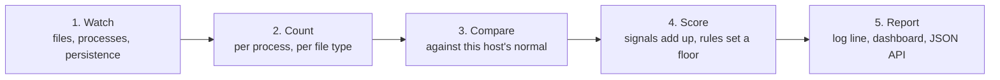

# GRIMA — the pitch, and the twelve cases we demonstrate

This document is for showing the project, not for building it. It says what GRIMA
is, what it claims, what we measured, and — case by case — what each of the
twelve demonstrations proves and what you should see on the screen. The commands
are in [Running the demonstration](#running-the-demonstration). The script itself
is `testdata/scenarios/demo.sh`.

---

## The one-paragraph version

GRIMA is a program that watches your files being changed and tells you, in plain
language, when the pattern looks like ransomware. It runs entirely in user space
— it installs no kernel driver, needs no administrator rights for its default
mode, and uses no machine learning or pretrained model. It learns what is normal
*on your machine* for a short warm-up period, then scores each burst of activity
against that, and every alert it produces can be read back as a sentence naming
the evidence that produced it. It is one static binary that we compile for
Windows, Linux and macOS from the same source.

## The problem, in plain words

Ransomware does not "look like" a virus. It looks like a program writing files —
which is what every program does. Two things make it hard:

1. **Scale.** A good encryption run rewrites thousands of files in seconds, so a
   detector that is slow is worse than useless: it falls behind while the files
   are being destroyed.
2. **Context.** "Writing 200 files per second" is alarming when `svchost.exe`
   does it and completely normal when a compiler, a backup, or `npm install`
   does it. Any fixed threshold either misses the attack or screams at the
   compiler.

And the usual answers to this have their own costs: a kernel driver is the most
powerful place to watch from, but it is also where system stability and
portability go to die, and it is exactly why administrators turn such tools off.

## What GRIMA does about it

It watches from user space using the notification APIs the operating system
already provides, and it solves the context problem by *measuring your host
first* instead of using a threshold someone picked on a different machine.

- It installs no driver, loads no kernel module, and needs no cgo.
- It uses no ML: no training, no model file, no inference step. Every decision is
  a formula you can read.
- It runs in observe mode by default. It does not delete, block or repair
  anything.
- Every alert is explainable: a score plus the named signals and their measured
  deviations.

## How it works, in five steps



1. **Watch.** Three sensors report what happened: file changes (create, write,
   rename, delete), process starts and exits, and new persistence entries like a
   cron job or a Run key. File writes are sampled — the first 4 KiB of the file,
   plus the last 4 KiB when the file is larger than 8 KiB, so at most 8 KiB per
   write and never a large file in full. That bound is a requirement, not an
   optimisation: reading whole files under an encryption storm is how a sensor
   falls behind the attack.
2. **Count.** Every process gets a rolling 30-second window (writes, creates,
   renames, deletes, bytes, directories touched, entropy of what was written)
   plus counters that never reset (files rewritten, bytes rewritten, which file
   types it touched).
3. **Compare.** During the warm-up, GRIMA measures what normal looks like here:
   how random each file type usually is, how many files per second are usually
   written, renamed and deleted, how many directories are usually touched. Those
   measured numbers become the thresholds.
4. **Score.** Twelve signals compare the current behaviour with that baseline.
   They combine so that evidence can only add: the score is
   `100 × (1 − (1−a) × (1−b) × …)` over the signals that fired and contribute —
   every Primary signal, plus a Secondary only while a Primary is present — where
   each `a`, `b` is that signal's weight times its normalised value. A separate
   layer of hard rules (deleting shadow copies, clearing the event log, touching
   a decoy file) does not add to the score at all — it sets a *floor* on the
   severity, so it cannot be averaged away by good behaviour.
5. **Report.** Everything lands in a log line, a live dashboard with a timeline
   and a findings feed, and a small JSON API (`/healthz`, `/api/verdicts`,
   `/api/trees`, `/api/history`, `/events`).

## The three ideas that make it different

**Two clocks, not one.** A rolling window is right for bursts and wrong for a
patient attacker, because one file every few seconds never fills any window. So
alongside the window there are counters that never decay: eventually the slow
attack accumulates into a verdict even though no single moment looked alarming.
Both tracks are scored and both can carry an alert.

**Calibration on your machine, not on a corpus.** The thresholds are not
constants in the source; they are distributions measured on the host during a
warm-up, and they can be re-measured later if a workload turns out to be benign.
This is the part our own measurements show matters most: the same set of signals
that is unusable without a baseline becomes safe with one (see the table below).

**Nothing is lost silently.** Every queue in the system is bounded — because an
encryption storm *is* an overload condition — and every drop, every failed watch
and every unwatched directory is counted and published through `/healthz`. A
detector that has gone blind says so, instead of looking healthy and quiet.
"Quiet" is never confused with "calibrated and quiet": before a baseline exists
the dashboard carries a banner and the API reports `calibration_ready: false`.

*(A note for the curious: the scorer computes twelve signals. `plan.md` says
thirteen because it counts the weight table, which also carries
`static_reputation` — a signal reserved for a later phase and not emitted yet.
`design.md` §5 is the authoritative list.)*

## What we measured

These are the project's own numbers, from `docs/sprints.md`. We separate what was
measured from what was not.

| Question | Result | Source |
|---|---|---|
| Does it catch a controlled encryptor? | Yes, all three rates: burst, drip, intermittent | `sprints.md` §27 |
| Detection rate at a 1% false-positive budget | **1.00** for the content signals alone | §27 |
| Time to detect, in bytes encrypted before the alert | median **136 KiB**, 95th percentile 9.5 MB | §27 |
| False positives, content-only signals | **0** alerts across the six benign workloads | §27 |
| False positives, shipped default config | All six workloads silent over two rounds; the worst peaks were npm 23.4 and atomic-save 21.7, both `low` | §5 item 4.1 |
| What happens without a baseline? | The rename/extension group has **no feasible false-positive point** — 16 benign alerts, so it is unusable until calibrated | §27 |
| Do the hard rules catch a generic encryptor? | **No** — 0 of 3. They are a floor for known anti-recovery commands, not a detector on their own | §27 |
| Cost to the machine | **3.25%** of one core idle (peak 5.74%) at 131 MiB; **6.11%** under load (peak 12.47%) at 159 MiB; the workload itself costs the same with and without the detector | §5 item 4.8 |
| Who wrote the file? (attribution) | Guessing from write volume was **0%** accurate (1,255 decisions). Reading the writer from Windows file-system auditing was **96.9%** (945 of 975) on an elevated host | `plan.md` §8, `architecture.md` §13 |
| Weight tuning | 101 candidate weight sets: **none beats the shipped one**. The differences come from which signals exist, not their weights | §27 |

## Running the demonstration

```sh
cd /home/prateek/Documents/projects/grima
make build                                       # produces ./grima

bash testdata/scenarios/demo.sh --list           # the twelve cases, with their claims
bash testdata/scenarios/demo.sh --interactive    # all of them, pausing so you can show the dashboard
bash testdata/scenarios/demo.sh --quick          # the four core cases plus the build check, about four minutes
bash testdata/scenarios/demo.sh --phases burst,decoy,rules     # any subset, in the order given
bash testdata/scenarios/demo.sh --work /tmp/grima-demo          # choose the work directory
```

Add `--keep` to keep the run's logs, baselines and configs for inspection. The
script writes nothing outside its own work directory; run it from the repository
root. `--interactive` prints a dashboard address before each workload and waits
for you to press Enter.

**One rule to explain up front, because it is a real property of the design:** the
warm-up must be busy. A baseline captured on an idle machine records no samples,
and then the deviation signals are reported as *unavailable* rather than as zero
— which is the honest behaviour, but it means a demonstration run has to drive
some ordinary writes during calibration. The script does this for you.

## The twelve cases

Each case is one phase of the script, and the script prints the matching case
number on screen, so this document and the terminal stay in step. (Before the
cases the script runs one setup step that checks the binary itself.) "What you
see" is the actual output from the verified run on Linux.

### 1. Burst encryption — mass modification, detected at critical

- **We do:** rewrite 55 files in one burst inside the monitored directory
  (`encryptor.py --rate burst`), each renamed to a new extension.
- **You see:** `score=100.0 level=critical ... signals="ngram_rename_chain;
  unknown_extension_activity; rename_burst; create_burst"`
- **Why it matters:** this is the core claim. Several independent pieces of
  evidence, none of them decisive alone, fuse into one critical verdict that
  states exactly what it saw.

### 2. Benign bulk rewriting — the false-positive control

- **We do:** three rounds of writing a temporary file and renaming it over the
  real file — 480 files per round across eight directories. This is what editors,
  config managers and installers do all day.
- **You see:** no alert at all. The detector may hold a low-level verdict (we
  observed 35, and 21.7–23.4 in the project's own corpus runs) which stays below
  the alert band; nothing at or above `medium` is ever emitted.
- **Why it matters:** a detector that alerts on this is unusable, and this is the
  case a rubric should hit hardest. It is also the case where calibration is
  doing the work.

### 3. Create-only storm — creates are counted, so they are scored

- **We do:** create 4,000 new files and never write to any of them.
- **You see:** `level=critical` with `signals="create_burst; unknown_extension_activity"`.
- **Why it matters:** this closes a measured bug. A process that only creates —
  an unpacker, a restore, a locker writing a note in every directory — used to be
  invisible: 12,026 creates in one second produced no verdict at all.

### 4. Intermittent (partial) encryption — the middle is left in plaintext

- **We do:** overwrite the first 8 KiB of each 30 KiB file with random bytes and
  leave the rest untouched, with no rename.
- **You see:** `signals="entropy_deviation; magic_mismatch"`.
- **Why it matters:** encrypting only part of each file is a deliberate trick to
  keep whole-file entropy looking normal. Because GRIMA samples the head and the
  tail instead of the whole file, there is nowhere for that trick to hide.

### 5. Tail-only overwrite — the tail sample is read

- **We do:** write 30 plain-text PDFs of 256 KiB, then overwrite only the last
  16 KiB of each with random bytes.
- **You see:** `signals=entropy_deviation`, and the fixture's own measurement
  alongside it: `head_mean=4.16 tail_mean=7.95 sampled_mean=6.84`.
- **Why it matters:** it proves the sampling is really head *and* tail. A detector
  that read only the beginning of each file would miss this entirely. The last
  number is the one compared against the baseline.

### 6. Drip encryption — the cumulative track, not the window

- **We do:** rewrite 24 high-entropy files of 4 MiB one per second — slow enough
  that the rolling window never fills — and rename each to `.locked`.
- **You see:** `level=medium` with `signals="ngram_rename_chain;
  cum_bytes_rewritten; unknown_extension_activity"`, and a score in the mid-40s
  (`45.2` and `45.8` in two runs — the score moves each tick as the window fills
  and empties, and an API poll during the run showed 57 at the peak).
- **Why it matters:** this is the patient attacker. Nothing in any single moment
  looks like a burst; the verdict is carried by counters that never reset.

### 7. Decoy touch — a canary is a critical override

- **We do:** append one line to the canary file GRIMA planted in the monitored
  directory. No real user ever created that file.
- **You see:** `score=0.0 level=critical override=R-DECOY-TOUCH`, and the note
  that this is the override contract rather than a bug: a rule sets a *floor on
  the severity*, it does not invent a score out of evidence that does not exist.
- **Why it matters:** it is the highest-precision signal in the system, and it
  shows the second half of the design — rules that cannot be averaged away.

### 8. Hard rules — anti-recovery commands

- **We do:** run a process whose command line is
  `vssadmin delete shadows /all /quiet`, launched in a way that makes it the head
  of its own process tree.
- **You see:** `level=critical override=R-SHADOW-DELETE`.
- **Why it matters:** rules are evaluated the instant a raw event arrives, not at
  the next scoring tick, because deleting shadow copies is what happens
  *before* the encryption. The class of attack that hides in the window is
  answered by counting; the class that announces itself in one command is
  answered immediately.
- **Say this part out loud if asked:** an override is attached to a process tree
  root, so a rule hit on a process buried in someone else's tree does not
  currently surface. That is a known gap, listed under limits below, and the
  script arranges the case so the behaviour is demonstrated honestly.

### 9. The rule predicates themselves

- **We do:** run the rule engine's own table-driven tests:
  `go test -count=1 -run 'Rule|Shadow|Decoy|Persist|Eventlog|Backup|Usn' ./internal/rules/`.
- **You see:** `ok github.com/prateekpurohit13/grima/internal/rules`.
- **Why it matters:** it separates the two claims people blur together — "the
  rule matches the right command lines" (tested here) and "a match reaches the
  verdict stream" (demonstrated in case 8).

### 10. Cooperative split — one workload, eight processes

- **We do:** start eight child processes that all pull work from one shared pool
  of 960 files, each claiming a file by creating an exclusive marker so that no
  child owns a private partition of the work.
- **You see:** `level=critical`, around `89` (`89.2` and `89.6` in two runs), with
  `write_rate_absolute` among the signals, and the detector reporting
  `no usable baseline` because this case is deliberately uncalibrated.
- **Why it matters:** splitting work across processes is the standard way to
  defeat a detector that looks at one process at a time. The evidence here is
  summed across the group, and with no baseline the fallback is an absolute rate
  rather than a comparison.

### 11. Uncalibrated mode — unknown is not reported as benign

- **We do:** run with no baseline at all, then perform the same benign rewrite
  that the calibrated detector stayed silent on.
- **You see:** the startup line `no usable baseline: deviation signals are
  inactive until one is captured`, `calibration_ready = false`, the dashboard
  banner, and no deviation signals in any verdict.
- **Why it matters:** this is the honesty requirement made visible. Reporting an
  unmeasured signal as `0` would say "nothing suspicious here" about something
  the system never measured.

### 12. Observability — every bounded queue counts what it lost

- **We do:** start the detector and read `/healthz`.
- **You see:** the real counters, including
  `bus published / dropped 411 / 0`, per-sensor event counts, `watch_failures`,
  `add_pending`, `history_dropped`, `sse_dropped`, and the number of samples
  behind every baseline distribution.
- **Why it matters:** it is how you tell "nothing happened" apart from "the
  detector stopped looking". Under an encryption storm the queues fill; the
  drops are counted, published, and used as evidence in their own right.

## How to read the screen

| Where | What it tells you |
|---|---|
| The alert line in the log | one line per alert: score, level, process, and the signals that carried it |
| Dashboard: risk timeline | score over time per tree, with the band lines at 20 / 45 / 70 / 88 |
| Dashboard: findings feed | newest first, only at or above the configured alert level, with the evidence sentence |
| Dashboard: signal panel | which signals are doing the work in this window |
| Dashboard: process trees | which processes contribute to a tree, and their own scores |
| `/healthz` | the honest counters: calibration state, drops, watch failures, baseline samples |

Severity bands are `info < 20`, `low < 45`, `medium < 70`, `high < 88`,
`critical ≥ 88`. Alerts start at `medium` by default. A verdict can exist below
the alert band — that is the dashboard's record of what happened, not an alert.

## Limits, stated plainly

- **Real ransomware families were never run.** The attack corpus is a controlled
  encryptor at three rates; running real families needs an isolated snapshot VM
  that this project did not have. Cross-family generalization is therefore
  unmeasured.
- **macOS compiles but has never been executed.** Windows and Linux are verified
  (the project's CI, plus Linux reproduced locally for this demo). No macOS claim
  is made.
- **Attribution is the weak link.** User-space APIs tell you *that* a file
  changed, not *who* changed it. Guessing from write volume scored 0%. The
  default mode therefore makes no per-process claim at all — file evidence is
  filed against the host — and the accurate mode (Windows file-system auditing)
  needs elevation. Linux has no causal source yet.
- **Known gap, found while building this demo:** a hard-rule hit on a process
  buried in another process's tree records an override that is not read, because
  overrides are looked up per tree root. The seven command-line rules are
  affected; the event-based rules (decoy, persistence) are not.
- **Known gap, being fixed:** a host-level verdict carries PID 0 (on every
  platform). Suspension is off by default and must be opted into; on Unix,
  suspending PID 0 would signal the whole process group, and the guard against
  that is the next fix.
- **Not a backup tool.** GRIMA detects and alerts. It does not decrypt, restore
  or block anything.
- **The monitor is a user-space process and can be killed.** Documented, not
  solved: the mitigation is deployment-level supervision.

## Where the numbers come from

The demonstration shows *behaviour*. The figures above come from these harnesses,
each in its own directory, each printing its evidence and exiting non-zero when a
check fails. Run one at a time.

| Command | What it produces | Roughly |
|---|---|---|
| `bash testdata/scenarios/smoke-linux.sh` | end-to-end pass: baseline, benign silent, encryptor critical | 1 min |
| `bash testdata/scenarios/rates.sh` | drip, quiet drip, intermittent, tail-only detection | 6 min |
| `bash testdata/scenarios/cerberus.sh` | the cooperative split, and an attribution characterisation | 3 min |
| `bash testdata/scenarios/benign-corpus.sh -n 2` | false positives over six benign workloads | 20 min |
| `bash testdata/scenarios/overhead.sh` | CPU and memory, against a no-detector control | 2 min |
| `python3 testdata/scenarios/ablate.py --rounds 3` | the ablation table: detection rate, time-to-detect, false positives per signal subset | 45 min/round |

Full detail, including the measurements behind every claim above, is in
[`sprints.md`](sprints.md). Interfaces and signal semantics are in
[`design.md`](design.md); the layer structure is in
[`architecture.md`](architecture.md); goals, decisions and open questions are in
[`plan.md`](plan.md).
